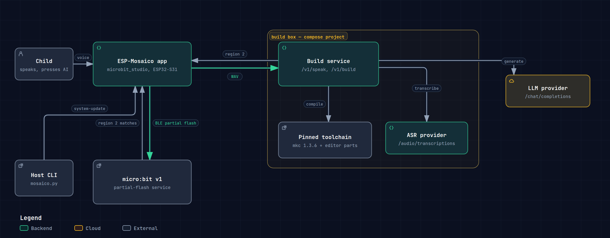

# esp-mosaico-microbit

A kid asks an **ESP-Mosaico** for something she wants to see on her **micro:bit**.
The Mosaico turns the request into a MakeCode program, has it compiled on a build
box, and sends it to the micro:bit over **Bluetooth LE**. The board picks up its new
program over the air.



Every box in that picture is drawn from source, with the file and line range it came
from recorded in the diagram's own JSON. [Interactive version][solution-html] ·
[regenerate it](docs/architecture/README.md).

## What a run looks like

1. **Speak to the Mosaico.** Press and hold the AI button, say what you want on the
   micro:bit, let go.
2. **The Mosaico does the rest.** It posts the recording to the build box, which
   transcribes it, writes a MakeCode program from what you said and compiles it. The
   panel walks through its states as each step lands: `LISTENING`, `BUILDING`,
   `CONNECTING`, `FLASH`, `VERIFY`, `DONE`. If a step fails, the panel shows `FAILED`
   with one plain sentence.
3. **The program is on the micro:bit.** The Mosaico finds the board over BLE, streams
   the image into its program region, then reconnects and reads that region back to
   prove it landed. The new program starts by scrolling its revision glyph, so you can
   see which build is running.

## Requirements

**Docker only.** Every tool runs in a container, so the host needs Docker and nothing
else.

| | |
|---|---|
| Docker Engine + Compose v2 | required |
| micro:bit v1 (nRF51822) | required for the hardware path |
| ESP-Mosaico | required for the end-to-end path |

## Quickstart

```sh
git clone --recurse-submodules https://github.com/ozanoner/esp-mosaico-microbit
cd esp-mosaico-microbit

cp .env.example .env          # add one LLM key: MB_LLM_API_KEY=...
make up                       # build box + ASR sidecar, first run builds both images

curl -s localhost:8477/v1/health
# {"status":"ok","toolchain_id":"mkc-1.3.6","template_dir":"/workspace/microbit/template","mkc":"mkc"}
```

The build box is up. Compiling a payload on its own is the quickest proof:

```sh
make build                    # microbit/payloads/hello.ts -> build/hello.hex
```

Then put the application on the board:

```sh
make firmware-hw              # ESP-IDF shell with the Mosaico's USB ports exposed
python3 mosaico.py iris system-update --project projects/microbit_studio
```

That builds the app, bundles it and installs it over USB into `main_app`. The retained
Vibe Mode image stays as it was, so `mosaico.py recover` keeps working. It needs the
Wi-Fi and build-box values from the next section compiled in first.

`make down` stops the containers. `make test` runs the unit tests only. `make verify` is
the reproducibility gate; see [docs/reproducibility.md](docs/reproducibility.md).

If `make up` reports `address already in use` for 8477, another process on the host owns
the port (`ss -ltnp | grep 8477`). Stop that process, then run `make down && make up`. A
container left behind by the failed bind has no port publish, so restarting it alone
will not help.

## Credentials

Two values run the whole chain. Only the second one is secret.

| What | Needed for | Where it goes |
|---|---|---|
| An OpenAI-compatible **LLM key** (default provider: DeepSeek) | `POST /v1/speak`, the step that writes the program | `.env` as `MB_LLM_API_KEY`, or `DEEPSEEK_API_KEY` |
| **Wi-Fi SSID, password and the build-box URL** | the Mosaico app, so it can reach the build box | firmware Kconfig: `CONFIG_MB_WIFI_SSID`, `CONFIG_MB_WIFI_PASS`, `CONFIG_MB_BUILD_SERVICE_URL`, `CONFIG_MB_VOICE_SERVICE_URL` |

**Everything else runs without credentials.** `/v1/health` and `/v1/build` open the box
up, and `make verify` reaches the same point, so the build box comes up and compiles
payloads with an empty `.env`. Only speech needs the key.

**Speech-to-text runs locally.** ASR is a `faster-whisper` sidecar in `asr/`, reachable
on the compose network, so it needs no key. Set `MB_ASR_BASE_URL` and `MB_ASR_API_KEY`
only to use a hosted transcriber instead.

**The device values are compiled in.** They live in the generated `build/sdkconfig`,
because the SSID is a secret and the URL depends on your bench.
`tools/preflight/preflight.sh` fails the build when they are empty or still point at
`127.0.0.1`.

**`GITHUB_TOKEN` in `.env.example` is for pushing to this repository.** No container
reads it.

Nothing secret lives in this repository or in any image. `.env` is gitignored **and**
dockerignored, so it cannot reach a commit or a build context.

## How it works

### The Mosaico: a vibe-coding app

The firmware is an ordinary ESP-Mosaico application, built in the `mosaico-idf`
container (ESP-IDF, pinned by image digest) and installed through Vibe Mode into
`main_app` (`app/ota_0`). The retained Vibe Mode and Recovery images stay untouched, so
`mosaico.py recover` and `system-update` keep working. **Every device operation runs
through `mosaico.py`.** ESP-Iris is what makes that possible: it exposes RPC, retained
logs, screenshots and the OTA path to the host tool.

On the device, four things share one event type (`mb_event_t`): `mb_voice` captures the
WAV and posts it, `mb_build_client` fetches the image, `mb_ble_central` with `mb_flash`
does the transfer, and `app_studio` decides which of the eight screens is on the
GSP-rendered panel. Only `app_studio` consumes those events, which is why the screen
layer can be replaced without touching the pipeline.

### The build box: speech in, region-2 bytes out

A micro:bit `.hex` can only be produced by MakeCode's compiler: `mkc` "compiles MakeCode
(PXT) projects by downloading parts of a released MakeCode web app and running them in
node.js". An ESP32 cannot run that compiler, so the box is part of the architecture.

`POST /v1/speak` takes `audio/wav` (or JSON `{"text": "..."}` to skip ASR) and runs the
whole chain server-side: ASR, then LLM, then `mkc build`, then hexkit. One retry is
allowed, and the second attempt carries the compiler's own output, so a wrong program
gets a second chance with the log attached. The prompt pins the shape: no imports, no
`pxt.json` changes, and a `REVISION` constant shown at boot so an image is identifiable.

The reply is the **region-2 byte stream** plus its geometry and the two hashes
(`?region2=true`), which is what the BLE client writes. Returning the hex would mean
about 1.8 MB of base64 for the device to parse. `GET /v1/health` reports the pinned
toolchain, and the image is built once with `npm ci` plus a warm-up compile, so runtime
builds need no network.

### The micro:bit update: BLE partial flashing

A MakeCode-built micro:bit v1 runs a partial-flash GATT service. Pairing is not
required, and a 20-byte write already fills the default ATT MTU, so the client skips the
MTU exchange. The flash splits into regions: the DAL (region 1) and the user program
(region 2, `0x37400 to 0x38BFF` for this template).

Five opcodes drive it: `REGION_INFO` (`0x00`), `WRITE_DATA` (`0x01`), `END_OF_TX`
(`0x02`), `STATUS` (`0xEE`) and `RESET` (`0xFF`). The Mosaico connects, reads region 1,
and compares the DAL hash with the image's. A mismatch stops there, before a single
block is written. Then region 2 is streamed in 64-byte blocks, paced by notifications,
the board resets on `END_OF_TX`, and the Mosaico reconnects to read region 2 back and
compare it with the program hash.

The verify pass exists because region 2 is written in place: a transfer that dies
mid-stream leaves a half-written program and no BLE service, recoverable only by one
USB bootstrap. The protocol reference, with the vendor sources it was read from, is
[docs/partial-flash-protocol.md](docs/partial-flash-protocol.md).

## Components

| Path | What it is | Runs on |
|---|---|---|
| `build-service/` | HTTP service: speech or MakeCode source in, `.hex` + region hashes out | container (`build-service/Dockerfile`) |
| `asr/` | `faster-whisper` sidecar behind an OpenAI-compatible transcripts endpoint | container (`asr/Dockerfile`) |
| `firmware/` | ESP-Mosaico application (voice, build client, NimBLE central, UI) | ESP32-S31 in the `mosaico-idf` container |
| `microbit/` | Pinned MakeCode template, PoC payloads, golden hashes | build input |
| `tools/hexkit/` | Intel HEX parsing, DAL magic/hash extraction, region-2 block packing | anywhere (reference for the C port) |
| `docs/` | Architecture, BLE protocol reference, bring-up gates, reproducibility | documentation only |

## Documentation

- [Architecture and contracts](docs/architecture.md)
- [Component view](docs/architecture/components.html): the monorepo's parts and the contracts between them ([static PNG](docs/architecture/components.png))
- [micro:bit v1 BLE partial-flash protocol](docs/partial-flash-protocol.md)
- [Bring-up gates](docs/bringup-gates.md)
- [Reproducibility](docs/reproducibility.md)

## Scope

micro:bit **v1 (nRF51822)** only. The partial-flash service ships only in MakeCode-built
images, so a board running MicroPython v1 has no BLE stack and needs one USB flash to
bootstrap.

## Licence

MIT. See [LICENSE](LICENSE).

[solution-html]: https://htmlpreview.github.io/?https://raw.githubusercontent.com/ozanoner/esp-mosaico-microbit/main/docs/architecture/solution.html
